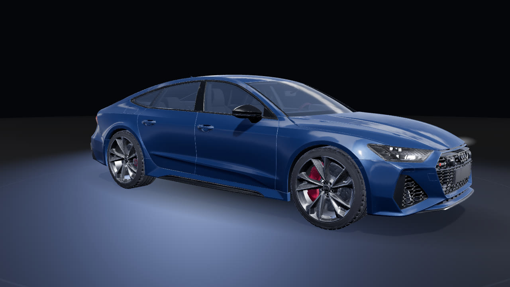
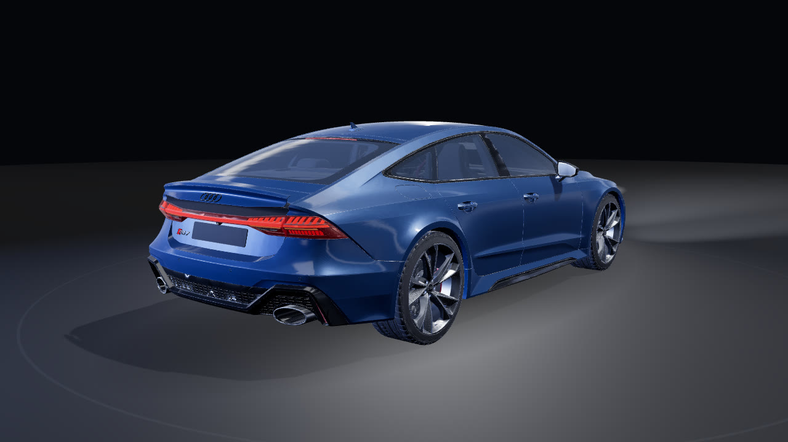
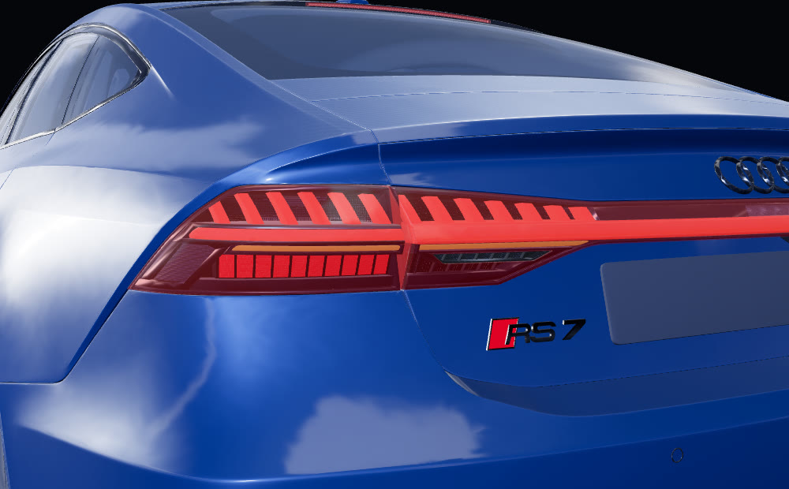

# Audi RS 7 Sportback performance — 3D fan website

An interactive scroll-driven website built around a 3D model of the Audi RS 7 Sportback performance (C8): rotate the car, take it apart in “X-ray” mode to see the engine, gearbox and suspension, and hear the V8 start up.

### 👉 [Live demo](https://parenok54.github.io/rs7-performance-3d-model/)

<p align="center">
  
  
</p>
<p align="center">
  <br/>
  <sub>Real-time renders from the site: front, rear with the spoiler deployed, LED tail lights.</sub>
</p>

## Features
- Real-time 3D car rendered in the browser with three.js
- Scroll-driven storytelling: the camera and model animate as you scroll through sections
- “X-ray” mode: body panels separate to reveal the engine, turbos, gearbox, differential and air suspension, with labels
- Deploying rear spoiler: the lip is cut out of the boot lid geometry at load time and rises in the Design and Performance sections
- Engine start button with sound, mute toggle
- Interactive 360° viewer and full technical specification table
- Compressed model (Meshopt) for faster loading
- Works on desktop and mobile, no build step — plain HTML, CSS and JavaScript

## Tech stack
- HTML, CSS, JavaScript
- [three.js](https://threejs.org/) r128 + GLTFLoader
- Meshopt decoder for the compressed model
- Web Audio API for the engine sound
- Hosted on GitHub Pages

## Run locally
```bash
git clone https://github.com/parenok54/rs7-performance-3d-model.git
cd rs7-performance-3d-model
python -m http.server 8000
# open http://localhost:8000
```

## Credits
- 3D model: [“Audi RS7”](https://sketchfab.com/3d-models/audi-rs7-54001647c1084605aad7525370d93bb8) by [Pisano Industries](https://sketchfab.com/PisanoIndustries), licensed under [CC BY 4.0](https://creativecommons.org/licenses/by/4.0/). The model was simplified, split into parts, recoloured and animated.
- Engine sound: [“fort_gt_001_mono_full.wav”](https://freesound.org/people/djbono/sounds/19338/) by djbono, licensed under Sampling+. Trimmed and processed.
- Specifications: official Audi MediaCenter materials.

Unofficial fan project, not affiliated with AUDI AG. Audi, RS 7, quattro and tiptronic are trademarks of AUDI AG.
